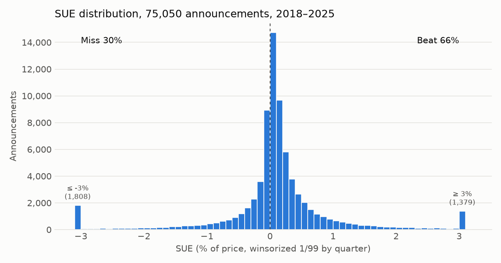

# Results

!!! info "Status"
    The data pipeline (E0) is complete. Regression results will be added here
    as experiments E1 to E7 are completed. The CAR comparisons below are
    descriptive only.

## Data availability

WRDS access check, run 2026-11-22 (`src/00_check_wrds_access.py`):

| Table | Latest date | Notes |
|---|---|---|
| `crsp.dsf` | 2024-12-31 | Legacy format, no longer updated |
| `crsp.dsf_v2` | **2025-12-31** | New CIZ format. **This is what sets the sample end** |
| `crsp.inddlyseriesdata` | 2025-12-31 | CRSP daily index series |
| `ibes.actu_epsus` | 2026-08-20 | I/B/E/S actual EPS |
| `ibes.statsum_epsus` | 2026-08-20 | I/B/E/S consensus |
| `comp.fundq` (`rdq`) | 2026-11-20 | Compustat report dates |
| `ff.fivefactors_daily` | 2026-09-30 | Fama-French factors |

**Decision:** the sample ends **2025-12-31**. Announcements up to mid-December
2025 keep a full post-announcement window.

## EDGAR release times

105,088 8-K Item 2.02 filings from 2018 to 2025 (`src/01_edgar.py`).

| Year | Filings | Firms |
|---|---|---|
| 2018 | 10,588 | 2,555 |
| 2019 | 11,015 | 2,691 |
| 2020 | 11,978 | 2,837 |
| 2021 | 13,006 | 3,198 |
| 2022 | 13,977 | 3,362 |
| 2023 | 14,388 | 3,468 |
| 2024 | 14,828 | 3,600 |
| 2025 | 15,308 | 3,736 |

**Release timing:**

| Window (ET) | Filings | Share |
|---|---|---|
| Before open (before 09:30) | 38,178 | 36% |
| During market hours | 7,205 | 7% |
| After close (16:00 or later) | 59,705 | 57% |

### Finding: SEC timestamps are UTC, not Eastern

Older advice says the `acceptanceDateTime` field's "Z" really means Eastern
time. **For the SEC submissions API this is wrong.** Nvidia's releases show
21:2x in winter and 20:2x in summer, which is 16:2x ET all year. Only true UTC
shifts with daylight saving like that. After conversion, every filing falls
inside EDGAR's 06:00 to 22:00 ET operating hours.

| Nvidia release | Accepted (ET) |
|---|---|
| 2025-02-26 | 16:21:32 |
| 2025-05-28 | 16:21:30 |
| 2025-08-27 | 16:22:14 |
| 2025-11-19 | 16:20:44 |
| 2026-08-26 | 16:21:19 (validation case) |

## Reaction days and mega-cap days

From `src/02_reaction_day.py`:

- **139 distinct mega-cap reaction days** from 2018 to 2025 (6 firms × 32
  scheduled releases = 192, with some days shared by two firms).
- **18,016 treated releases** (other firms whose reaction day is a mega-cap
  day), about 17% of all releases. Mega-cap days fall in peak earnings weeks,
  which is why the same-day announcement count is a key control.
- 7,191 releases (6.8%) are intraday.
- Four mega-cap 2.02 filings are unscheduled revenue warnings or previews and
  are excluded from treatment (see the [Data guide](data.md)).

| Trading days from nearest mega day | −5 | −4 | −3 | −2 | −1 | **0** | +1 | +2 | +3 | +4 | +5 |
|---|---|---|---|---|---|---|---|---|---|---|---|
| Releases | 4,082 | 3,898 | 2,935 | 4,079 | 7,390 | **18,016** | 6,234 | 6,332 | 6,686 | 8,780 | 6,949 |

### Validation: Nvidia, 26 August 2026

`python src/02_reaction_day.py --check` applies the rule to every 8-K Item
2.02 filed on 26 and 27 August 2026:

- **Nvidia** (16:21 Wed) and **Veeva** (16:06 Wed) both get reaction day
  **27 Aug**. Pass.
- **29 filers** have reaction day 27 Aug (Wed after close or Thu before open),
  against 15 major firms on Bloomberg's list. These include Salesforce,
  CrowdStrike, Okta, Nutanix, HP, Synopsys, Agilent, Dollar Tree, Dollar
  General, Best Buy and Burlington.
- **13 filers** reported Wed morning and are **not treated** (Kohl's,
  Smucker, Abercrombie & Fitch, Williams-Sonoma and others), even though they
  share Nvidia's calendar date.
- Some filers are funds or crypto-treasury shells (e.g. Fidelity Private
  Credit Fund, Hyperliquid Strategies). The US common-stock filter in
  `03_links.py` removes them.
- Three intraday releases are flagged with `intraday = 1`.

## Identifier links

From `src/03_links.py` (`output/match_rate.md`), checked at each announcement date:

| Step | Announcements | % of all |
|---|---|---|
| All EDGAR 8-K 2.02 announcements | 105,088 | 100.0% |
| with GVKEY | 104,975 | 99.9% |
| with PERMNO (CCM link in range) | 100,901 | 96.0% |
| with I/B/E/S ticker | 95,859 | 91.2% |
| US common stock | 86,568 | 82.4% |
| **US common stock with all three IDs (sample)** | **82,735** | 78.7% |

**Match rate among US common stocks: 95.6%** (target 90%). Every year is
between 94.8% and 97.0%, and all 196 mega-cap filings link. The 17.6% of
announcements that are not US common stock are mostly REITs, ADRs, funds and
firms not listed on NYSE, AMEX or Nasdaq. They are excluded by design.

| Year | US common | All three IDs | Rate |
|---|---|---|---|
| 2018 | 8,423 | 8,170 | 97.0% |
| 2019 | 8,854 | 8,550 | 96.6% |
| 2020 | 9,700 | 9,352 | 96.4% |
| 2021 | 10,698 | 10,138 | 94.8% |
| 2022 | 11,662 | 11,140 | 95.5% |
| 2023 | 12,043 | 11,478 | 95.3% |
| 2024 | 12,401 | 11,773 | 94.9% |
| 2025 | 12,787 | 12,134 | 94.9% |

## Earnings surprise (SUE)

From `src/04_sue.py` (`output/sue_summary.md`):

| Step | Announcements | % of linked sample |
|---|---|---|
| Linked US common stocks | 82,735 | 100.0% |
| Matched to an I/B/E/S actual (within 3 days) | 70,992 | 85.8% |
| With a consensus before the release | 70,434 | 85.1% |
| Price ≥ $5 | **59,775** | 72.2% |

| Year | N | Miss | Meet | Beat | % miss | Median SUE (% of price) | Median analysts |
|---|---|---|---|---|---|---|---|
| 2018 | 6,158 | 1,637 | 410 | 4,111 | 26.6% | 0.060 | 7 |
| 2019 | 6,453 | 1,894 | 399 | 4,160 | 29.4% | 0.053 | 8 |
| 2020 | 6,680 | 1,814 | 245 | 4,621 | 27.2% | 0.116 | 7 |
| 2021 | 7,994 | 2,049 | 260 | 5,685 | 25.6% | 0.112 | 7 |
| 2022 | 7,956 | 2,412 | 350 | 5,194 | 30.3% | 0.077 | 7 |
| 2023 | 7,904 | 2,379 | 340 | 5,185 | 30.1% | 0.076 | 7 |
| 2024 | 8,207 | 2,429 | 384 | 5,394 | 29.6% | 0.069 | 7 |
| 2025 | 8,423 | 2,249 | 389 | 5,785 | 26.7% | 0.078 | 7 |

- **Enough negative surprises:** 1,600 to 2,400 misses every year (26% to
  30%), so the long-short portfolio has a short leg in every year.
- The distribution is sharply peaked just above zero (firms narrowly beating
  consensus) with fat tails, which is why SUE is winsorized.
- **EDGAR vs I/B/E/S dates:** same day for 94.7%, I/B/E/S one day *earlier*
  for 3.5%, one day later for 1.2%. The "one day earlier" cases are firms whose
  press release came out before the 8-K was filed. See the follow-up below.
- 17 observations needed a split adjustment between consensus and announcement.

!!! todo "Follow-up: release time for the 3.5% where I/B/E/S is earlier"
    For 2,084 announcements the I/B/E/S date is the day before the EDGAR
    filing. Where the press release came out the previous morning, our
    reaction day is one day late. I/B/E/S also has an announcement time
    (`anntims`), so the fix is to take the earliest credible time of EDGAR and
    I/B/E/S, as the proposal planned.

## Treated / control matching

From `src/05_match.py` (`output/match_summary.md`):

- **12,568 treated announcements** from 1,781 firms on **139 mega-cap
  events** (32 per mega-cap; some days are shared).
- **Controls (1:1, with replacement):** 8,310 announcements from 2,060 firms.
  The 1:3 robustness match uses 16,112.
- Every treated firm found a control. 65% matched within the same event and
  FF12 industry; 35% used the same-quarter fallback.

| Mega-cap | Treated | Same-quarter fallback |
|---|---|---|
| NVDA | 1,105 | **0%** |
| AAPL | 3,467 | 11% |
| AMZN | 3,143 | 27% |
| GOOGL | 2,922 | 28% |
| MSFT | 3,257 | 32% |
| META | 4,530 | 62% |

Nvidia reports late in each earnings season, away from the other mega-caps,
so every Nvidia-day firm finds a control in its own event. Meta, Microsoft and
Alphabet often report in the same week, which leaves few clean control days.

| Balance (1:1, medians) | Treated | Control |
|---|---|---|
| Market cap ($M) | 3,607 | 3,726 |
| SUE (% of price) | 0.080 | 0.080 |
| % miss | 24.0% | 23.3% |
| Analysts | 8 | 8 |

## Abnormal returns (CAR)

From `src/06_car.py` (`output/car_summary.md`). Market = CRSP value-weighted
index (CIZ indno 1000200, identical to legacy `vwretd`).

| | Coverage |
|---|---|
| CAR(0,+1), market model | 98.4% |
| CAR(0,+1), market-adjusted | 100% |
| CAR(+2,+60), market model | 94.8% (missing after 2 Oct 2025: not enough data yet) |

**WRDS spot check (10 random events):** daily returns are identical to the
WRDS Event Study tool. CAR(0,+1) differs by at most 0.09 percentage points.
CAR(+2,+60) differs by at most 1.55 pp (mean about 0.4 pp), because the tool's
market benchmark is slightly different from `vwretd` and the difference adds
up over 59 days. Our estimation window (−250 to −30) is the closest fit to
the tool's α and β of every window we tried.

!!! note "Long-window level"
    CAR(+2,+60) averages −2.0% (market model). The typical stock has
    underperformed a market led by the mega-caps since 2018. This affects
    treated and control firms alike, so it cancels in the comparison, but a
    size-matched or factor benchmark is a planned robustness check.

### First look: CAR path, treated vs control

1:1 matched sample with a complete +60 window. **Descriptive only:** no
controls, no standard errors.

- **Day 0:** treated and control lines jump by almost the same amount. No sign
  of a weaker reaction on mega-cap days.
- **Drift:** after bad news, treated firms keep falling *less* than controls
  (about −3.8% vs −4.5% by day 60). That is the opposite of H1's prediction.

### Drift by surprise quintile (mean CAR, %)

| SUE quintile | CAR(0,+1) control | CAR(0,+1) treated | CAR(+2,+60) control | CAR(+2,+60) treated |
|---|---|---|---|---|
| Q1 (worst) | −3.96 | −3.77 | −0.76 | 0.24 |
| Q2 | −1.21 | −1.82 | −2.41 | −1.83 |
| Q3 | 0.72 | 0.22 | −2.22 | −1.92 |
| Q4 | 1.46 | 1.73 | −1.39 | −1.14 |
| Q5 (best) | 4.07 | 4.11 | −1.02 | −0.75 |
| **Q5 − Q1** | **8.03** | **7.89** | **−0.26** | **−0.99** |

- **Immediate reaction:** the Q5 − Q1 spread is almost the same for treated
  (7.89%) and control (8.03%) firms.
- **Drift:** the long-short drift is slightly *negative* in both groups, so
  there is no classic post-earnings drift in 2018 to 2025. It is more negative
  for treated firms, driven by worst-surprise firms partly reversing. H1
  predicts the opposite.
- With CAR(+2,+60) standard deviations near 23%, these gaps are within about
  one to two standard errors. The regressions (E1, E2) will test them
  properly.

## Control variables

From `src/07_controls.py` (`output/controls_summary.md`):

| Control | Missing (all) | Missing (1:1 sample) | Median |
|---|---|---|---|
| logsize | 0.0% | 0.0% | 7.89 (≈ $2.7B) |
| bm | **6.4%** | **5.0%** | 0.38 |
| log_analysts | 0.0% | 0.0% | 2.08 (7 analysts) |
| pastret | 2.4% | 1.2% | 7.6% |
| samedaycount | 0.0% | 0.0% | 135 |

`bm` is above 5% because 3,590 announcements come from firms with negative
or zero book equity, where book-to-market is undefined. Only 236 (0.4%) lack
Compustat data. Plan: set bm = 0 with a negative-book-equity dummy in the
main spec, and drop those firms as a robustness check.

Treated firms report on busier days than controls (median 170 vs 146 other
announcements), which is why the same-day count is a control.

## Early analysis: Nvidia, 26 August 2026

From the proposal, using Bloomberg's calendar of major US firms:

| Group | Firms | Median surprise | Mean surprise |
|---|---|---|---|
| Wed before open (not treated) | 4 | 30.6% | 56.9% |
| Wed after close and Thu before open (**treated**) | 15 | 15.5% | 30.3% |
| Thu after close (day +1, skipped) | 9 | 7.4% | 180.3% |

- The reaction-day rule matters: four firms on Nvidia's calendar date reported
  before the open and are not treated.
- Every firm with an estimate beat it, so the full sample is needed to get
  enough negative surprises.
- Percentage surprises are badly skewed, which is why SUE is scaled by price
  and winsorized.

## Regression results

_To be added: E1 to E7._
