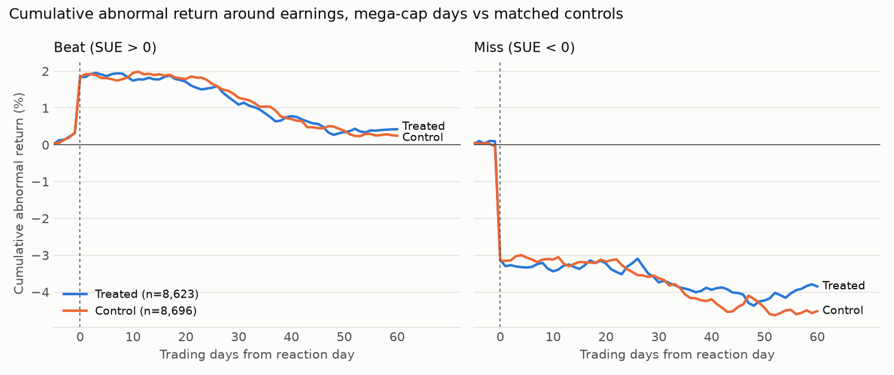

# Results

!!! info "Status"
    Data pipeline (E0) and main regressions (E1, E2, market-move control)
    are complete. **Headline: attention to treated firms falls on mega-cap
    days, but prices respond normally (β₃ ≈ 0).** Remaining tests (portfolio, placebo, robustness,
    attention check) are listed on [Experiments](experiments.md). Sections
    below go from the main result to how the data were built.

## Tables for the paper

Every table is a self-contained LaTeX `table` float (needs
`\usepackage{booktabs}`). From `paper/main.tex`, include one with
`\input{../output/tables/<file>}`.

| Paper table | File | Made by |
|---|---|---|
| 1. Sample by year | [`output/tables/summary.tex`](https://github.com/FIN-552-Applied-Econometrics-Research/megacap_attention/blob/main/output/tables/summary.tex) | `notebooks/10_summary.ipynb` |
| 2. Descriptive statistics | same file as Table 1 | `notebooks/10_summary.ipynb` |
| 3. Balance test | [`output/tables/balance.tex`](https://github.com/FIN-552-Applied-Econometrics-Research/megacap_attention/blob/main/output/tables/balance.tex) | `notebooks/10_summary.ipynb` |
| 4. Main regressions, all firms (base and + market move) | [`output/tables/main.tex`](https://github.com/FIN-552-Applied-Econometrics-Research/megacap_attention/blob/main/output/tables/main.tex) | `src/08_regress.py` |
| 6. Calendar-time portfolio alphas | [`output/tables/alpha.tex`](https://github.com/FIN-552-Applied-Econometrics-Research/megacap_attention/blob/main/output/tables/alpha.tex) | `src/09_portfolio.py` |
| 7. Attention (Wikipedia pageviews) | [`output/tables/attention.tex`](https://github.com/FIN-552-Applied-Econometrics-Research/megacap_attention/blob/main/output/tables/attention.tex) | `src/11_attention.py` |
| 8. Robustness: same-week twins only | [`output/tables/robust_sameweek.tex`](https://github.com/FIN-552-Applied-Econometrics-Research/megacap_attention/blob/main/output/tables/robust_sameweek.tex) | `src/12_robust_sameweek.py` |
| 5. Main regressions, small and low-coverage halves | [`output/tables/main_halves.tex`](https://github.com/FIN-552-Applied-Econometrics-Research/megacap_attention/blob/main/output/tables/main_halves.tex) | `src/08_regress.py` |

| Figure | File | Made by |
|---|---|---|
| SUE distribution | `output/figures/sue_hist.png` | `src/04_sue.py` |
| Event-time placebo | `output/figures/placebo.png` | `src/10_placebo.py` |
| CAR paths, treated vs control | `output/figures/car_paths.png` | `notebooks/06_car_checks.ipynb` |

## Main result (β₃)

From `src/08_regress.py` (`output/tables/main.tex`, `main_halves.tex`).
1:1 matched sample; SUE, CARs and |market return| in percent; controls,
industry and quarter fixed effects; standard errors clustered by reaction day.
"+ Market move" adds |market return on the reaction day| and its interaction
with SUE (card 12).

**Table 4: all firms**

| | (1) CAR(0,+1) | (2) CAR(0,+1) + market move | (3) CAR(+2,+60) | (4) CAR(+2,+60) + market move |
|---|---|---|---|---|
| SUE (β₁) | 1.994*** (5.05) | 2.108*** (5.01) | −0.913 (−0.60) | −0.955 (−0.61) |
| MegaDay (β₂) | −0.099 (−0.65) | −0.077 (−0.50) | 0.622 (1.64) | 0.628* (1.65) |
| **SUE × MegaDay (β₃)** | **−0.028 (−0.09)** | **0.046 (0.15)** | **−0.191 (−0.29)** | **−0.222 (−0.35)** |
| \|Market return\| × SUE | | −0.169 (−0.97) | | 0.064 (0.22) |
| 95% CI for β₃ | [−0.63, 0.58] | [−0.55, 0.65] | [−1.48, 1.10] | [−1.48, 1.04] |
| Fama-MacBeth β₃ | 0.237 (0.89) | −0.020 (−0.06) | −0.259 (−0.28) | −0.930 (−0.69) |
| N | 24,815 | 24,815 | 24,145 | 24,145 |
| R² | 0.047 | 0.047 | 0.207 | 0.207 |

**Table 5: β₃ in the halves where crowding out should be strongest**

| | Small, CAR(0,+1) | Small, CAR(+2,+60) | Low cov., CAR(0,+1) | Low cov., CAR(+2,+60) |
|---|---|---|---|---|
| β₃, base | −0.186 (−0.56) | −0.084 (−0.12) | −0.229 (−0.63) | −0.267 (−0.31) |
| β₃, + market move | −0.104 (−0.32) | −0.100 (−0.14) | −0.132 (−0.37) | −0.328 (−0.40) |
| N | 12,327 | 11,994 | 12,342 | 12,021 |

*t*-statistics in parentheses. Crowding out (H1) predicts β₃ < 0 for
CAR(0,+1) and β₃ > 0 for CAR(+2,+60).

!!! info "Market move vs distraction (card 12)"
    Mega-cap days do move the market more (median |return| 0.76% vs 0.59%
    on control days), but controlling for it leaves β₃ essentially unchanged
    (−0.03 → 0.05 for CAR(0,+1), −0.19 → −0.22 for drift, all insignificant),
    so the market move was not hiding any crowding out. In the small-firm and
    low-coverage halves β₃ becomes *less* negative, which means the small
    negative point estimates there partly reflected the market move rather
    than distraction.

!!! abstract "What β₃ means"
    Across every specification, β₃ is close to zero and far from significant. In the main model a 1 percentage point earnings surprise moves the two-day CAR by 1.99% on an ordinary day (β₁, t = 5.05), and on a mega-cap day by essentially the same amount (β₃ = −0.03, t = −0.09). The 95% confidence interval of [−0.63, 0.58] rules out a change of more than about a third of the normal response in either direction (−32% to +29% of β₁). The drift model gives the same answer (β₃ = −0.19, t = −0.29, CI [−1.48, 1.10]), and so do the small-firm and low-coverage halves, where crowding out should be strongest. Their CAR(0,+1) point estimates are slightly negative (about −10% of β₁), but they are insignificant, and the matching drift coefficients have the wrong sign for H1. Fama-MacBeth estimates agree. We therefore find no evidence that mega-cap earnings days either crowd out or crowd in the pricing of other firms' news in 2018 to 2025. Two caveats bound this null. The interval still includes effects as large as the 17% macro-day effect of Hirshleifer and Sheng (2022). And β₁ in the drift model is itself insignificant: there is little post-earnings drift in this period for a distraction effect to create.

## Robustness: same-week twins only (Table 8)

From `src/12_robust_sameweek.py`. 35% of treated announcements had no
same-industry twin in their own event week and borrowed one from elsewhere in
the quarter. This keeps only the pairs matched within the same week and re-runs
Table 4 with identical controls and clustering.

| | CAR(0,+1), all twins | CAR(0,+1), same week | CAR(+2,+60), all twins | CAR(+2,+60), same week |
|---|---|---|---|---|
| β₃, base | −0.028 (t = −0.09) | **−0.314 (t = −0.96)** | −0.191 (−0.29) | −0.018 (−0.02) |
| 95% CI | [−0.63, 0.58] | [−0.96, 0.33] | [−1.48, 1.10] | [−1.65, 1.61] |
| β₃, + market move | 0.046 (0.15) | −0.186 (−0.57) | −0.222 (−0.35) | −0.145 (−0.18) |
| N | 24,815 | 16,058 | 24,145 | 15,388 |

| Mega-cap | Treated | Same-week twin | Kept |
|---|---|---|---|
| NVDA | 1,105 | 1,100 | 100% |
| AAPL | 3,467 | 3,102 | 89% |
| AMZN | 3,143 | 2,295 | 73% |
| GOOGL | 2,922 | 2,113 | 72% |
| MSFT | 3,257 | 2,210 | 68% |
| META | 4,530 | 1,714 | 38% |
| **All** | **12,568** | **8,121** | **65%** |

Events with at least one same-week pair: 103 of 139.

!!! info "Does the null hold?"
    **Yes.** Keeping only same-week twins costs 35% of the treated
    announcements (Meta keeps only 38%) and 36 of 139 events. The immediate-
    reaction β₃ moves from −0.03 to −0.31, in the crowding-out direction
    (about 15% of the normal response of 2.04), but it stays far from
    significant (t = −0.96) and its confidence interval overlaps the
    baseline almost completely. With the market-move control it is −0.19
    (t = −0.57). The drift β₃ stays at zero. The borrowed twins were not
    hiding a crowding-out effect; at most they diluted a small one we cannot
    distinguish from zero.

## Attention check (Table 7)

From `src/11_attention.py` (`output/tables/attention.tex`). English
Wikipedia pageviews (users, all access), with each firm's page found through
the SEC CIK recorded in Wikidata (P5531). Abnormal views = log(1 + views on
the reaction day) − log(1 + median daily views over the 56 days ending 3 days
before). 1:1 matched sample; 57% of announcements have a page (6,486 treated,
6,397 control).

| | Treated | Control | Difference |
|---|---|---|---|
| Abnormal views, mean (log points) | 0.213 | 0.270 | −0.057 (t = −9.00) |
| Implied change vs baseline | +23.7% | +31.0% | |
| Matched pairs (4,160) | | | −0.064 (t = −8.71) |
| Regression on MegaDay, clustered by day | | | −0.057 (t = −4.31) |
| **+ controls** (day of week, quarter, industry, baseline views, size, analysts, same-day count) | | | **−0.029 (t = −3.51)** |
| Nvidia days only, with controls | | | −0.014 (t = −0.71) |
| Other five mega-caps, with controls | | | −0.029 (t = −3.46) |
| Same-event matches only, with controls | | | −0.018 (t = −1.98) |

!!! success "Attention moves, prices do not"
    **Attention to treated firms does drop on mega-cap days.** Both groups get
    more Wikipedia traffic on their earnings day, but treated firms get
    noticeably less of a boost (+24% vs +31%). About half of the raw gap
    comes from timing (day of week and season); a robust gap of about 3% of
    views remains with full controls (t = −3.5). The drop comes from the five
    mega-caps that report in clustered peak weeks; Nvidia days alone show no
    significant drop.

    Put together with β₃ ≈ 0 (Table 4), the evidence says mega-cap days do
    **crowd out attention but not price discovery**: earnings news is
    priced just as fast and as fully even when fewer people look at the
    firm. That fits the proposal's alternative: professional and algorithmic
    readers of disclosures, rather than the retail attention Wikipedia
    measures, set prices on earnings days.

Caveats: Wikipedia measures mostly retail and casual attention, and firms
with a page are larger and better known than the average sample firm.

## Calendar-time portfolio alphas (Table 6)

From `src/09_portfolio.py` (`output/tables/alpha.tex`). Each quarter all
announcements are sorted into SUE quintiles. The portfolio buys top-quintile
and sells bottom-quintile announcements, holding each from day +2 to +61,
equal-weighted. Daily long-short returns; Newey-West (10 lags) *t*-statistics.
Factors from Ken French's data library.

| | Treated | Control | Treated − Control |
|---|---|---|---|
| CAPM alpha (% per year) | 4.15 (t = 1.11) | 7.58* (t = 1.83) | −3.06 (t = −0.65) |
| **FF5 + UMD alpha (% per year)** | **3.00 (t = 0.83)** | **6.61 (t = 1.64)** | **−3.20 (t = −0.68)** |
| Avg. stocks long / short | 70 / 58 | 46 / 41 | |
| Days (dropped: < 5 per side) | 1,976 (12) | 1,985 (8) | 1,974 |
| Break-even cost (bp per one-way trade) | 14.0 | 33.8 | |

- **No significant drift alpha in either group.** Once the six factors are
  included, neither long-short portfolio earns a significant alpha. The
  significant RMW and UMD loadings show that good-news firms tend to be
  profitable past winners.
- **Treated firms drift *less*, not more** (−3.2% per year relative to
  controls, insignificant). H1 predicts the opposite, matching the regressions.
- **Not tradable after costs.** Break-even costs of 14 bp (treated) and 34 bp
  (control) per trade are at or below typical spreads for small and mid caps.

!!! warning "Market-model α distorts the 60-day drift"
    The Q5 − Q1 CAR(+2,+60) was negative with market-model CARs
    (treated −0.99%, control −0.26%) but **positive** with market-adjusted
    CARs (+0.93%, +0.57%). Bad-news firms had falling prices before the
    announcement, so their estimated α is negative, and carrying it forward
    over 59 days inflates their measured drift; the reverse holds for good
    news. This is the long-horizon problem of Fama (1998) and Lyon, Barber
    and Tsai (1999). The calendar-time portfolio avoids it. **Re-running the
    drift regression with market-adjusted CARs leaves β₃ at zero**
    (0.16, t = 0.25; with the market-move control 0.05, t = 0.09), so the
    main result is unaffected.

## Event-time placebo

From `src/10_placebo.py`. The main model with SUE × Day\(_k\) for
\(k = -3, \dots, +3\) trading days from the nearest mega-cap reaction day, in
place of SUE × MegaDay. Full sample of 59,583 non-mega-cap announcements; the
reference group is announcements 4 or more trading days from any mega-cap day.
Same controls, fixed effects and clustering as Table 4.

| k | −3 | −2 | −1 | **0** | +1 | +2 | +3 |
|---|---|---|---|---|---|---|---|
| CAR(0,+1) | 0.61 (1.54) | 0.58 (1.62) | 0.96 (3.01) | **0.80 (3.24)** | 0.39 (1.31) | 0.88 (3.64) | 0.77 (3.08) |
| CAR(+2,+60) | −0.17 (−0.22) | 0.21 (0.30) | −0.36 (−0.86) | **−0.33 (−0.92)** | 0.16 (0.32) | −0.86 (−0.75) | 0.83 (2.15) |

*t*-statistics in parentheses. Normal response to SUE in this sample:
β₁ = 1.33 (CAR(0,+1)), 0.43 (CAR(+2,+60)).

- **No peak at the mega-cap day.** Day 0 (0.80) sits right at the average of
  the six surrounding days (0.70), well inside every neighbour's confidence
  interval.
- **The whole window around mega-cap days reacts more strongly than the
  reference group.** All seven CAR(0,+1) coefficients are positive. This is a
  peak-season effect: announcements far from any mega-cap day are off-peak
  reporters, whose news gets a weaker response. It is not anticipation of the
  mega-cap, so the positive pre-day-0 coefficients are not the red flag the
  test looks for.
- This is the same null as Table 4 from a different angle: the matched design
  compares day 0 with days ±2 to ±5, and 0.80 vs about 0.8 gives β₃ ≈ 0.
- Drift: no pattern; one of the 14 coefficients (+3 days, drift) is
  significant at 5%, about what chance alone would produce.

## Sample and balance

From `notebooks/10_summary.ipynb` (`output/tables/summary.tex`,
`output/tables/balance.tex`), 1:1 matched sample.

### Table 1: sample by year

| Year | Events | Treated ann. | Treated firms | Control ann. (1:1) | Control firms (1:1) | Control ann. (1:3) |
|---|---|---|---|---|---|---|
| 2018 | 19 | 1,517 | 812 | 858 | 636 | 1,489 |
| 2019 | 20 | 1,543 | 800 | 978 | 705 | 1,731 |
| 2020 | 15 | 1,124 | 685 | 817 | 652 | 1,684 |
| 2021 | 16 | 1,481 | 798 | 1,028 | 770 | 2,096 |
| 2022 | 18 | 1,664 | 779 | 1,155 | 798 | 2,256 |
| 2023 | 18 | 1,862 | 932 | 1,183 | 834 | 2,274 |
| 2024 | 17 | 1,735 | 1,003 | 1,185 | 917 | 2,367 |
| 2025 | 16 | 1,642 | 974 | 1,106 | 846 | 2,215 |
| **Total** | **139** | **12,568** | **1,781** | **8,310** | **2,060** | **16,112** |

Firm totals count each firm once.

### Table 2: descriptive statistics (1:1 sample)

| | Treated mean | Treated median | Treated SD | Control mean | Control median | Control SD |
|---|---|---|---|---|---|---|
| SUE (% of price) | 0.124 | 0.080 | 0.884 | 0.118 | 0.080 | 0.812 |
| Negative surprise (share) | 0.240 | 0 | 0.427 | 0.233 | 0 | 0.423 |
| Log market cap ($M) | 8.264 | 8.177 | 1.741 | 8.289 | 8.204 | 1.714 |
| Book-to-market | 0.497 | 0.396 | 0.410 | 0.479 | 0.367 | 0.403 |
| Log(1 + analysts) | 2.140 | 2.197 | 0.688 | 2.162 | 2.197 | 0.675 |
| Past return, −12 to −2 (%) | 17.35 | 8.92 | 48.82 | 16.76 | 8.36 | 50.37 |
| Same-day announcements | 170.3 | 170 | 65.3 | 144.9 | 126 | 96.7 |
| CAR(0,+1) (%) | 0.214 | 0.130 | 8.569 | 0.341 | 0.359 | 8.956 |
| CAR(+2,+60) (%) | −1.185 | −0.981 | 17.598 | −1.656 | −1.013 | 20.109 |

N = 12,568 per group (fewer where a variable is missing; see `summary.tex`).

### Table 3: balance test

| Variable | Treated | Control | Difference | *t* | Std. diff. |
|---|---|---|---|---|---|
| SUE (% of price) | 0.124 | 0.118 | 0.006 | 0.52 | 0.007 |
| Negative surprise (share) | 0.240 | 0.233 | 0.007 | 1.37 | 0.017 |
| Log market cap | 8.264 | 8.289 | −0.025 | −1.16 | −0.015 |
| Book-to-market | 0.497 | 0.479 | 0.018*** | 3.45 | 0.045 |
| Log(1 + analysts) | 2.140 | 2.162 | −0.022** | −2.54 | −0.032 |
| Past return (%) | 17.35 | 16.76 | 0.59 | 0.94 | 0.012 |
| Same-day announcements | 170.3 | 144.9 | 25.3*** | 24.33 | **0.307** |

!!! success "Balance verdict"
    **The groups are balanced on everything a firm could choose or that
    matching targeted.** SUE is almost identical (0.124% vs 0.118% of price,
    *t* = 0.52, std. diff. 0.007), and so is the share of negative surprises
    (24.0% vs 23.3%), so there is no sign that firms pick mega-cap days to
    hide bad news; every other pre-announcement variable has a standardized
    difference below 0.05, and the two significant ones (book-to-market and
    analyst coverage) are significant only because of the large sample.
    The one real difference is the same-day announcement count (std. diff.
    0.31), higher for treated firms by construction because mega-cap days
    fall in peak earnings weeks; it enters every regression as a control.

## Treated / control matching

From `src/05_match.py` (`output/match_summary.md`):

- **12,568 treated announcements** from 1,781 firms on **139 mega-cap
  events** (32 per mega-cap; some days are shared).
- **Controls (1:1, with replacement):** 8,310 announcements from 2,060 firms.
  The 1:3 robustness match uses 16,112.
- Every treated firm found a control. 65% matched within the same event and
  FF12 industry; 35% used the same-quarter fallback.

| Mega-cap | Treated | Same-quarter fallback |
|---|---|---|
| NVDA | 1,105 | **0%** |
| AAPL | 3,467 | 11% |
| AMZN | 3,143 | 27% |
| GOOGL | 2,922 | 28% |
| MSFT | 3,257 | 32% |
| META | 4,530 | 62% |

Nvidia reports late in each earnings season, away from the other mega-caps,
so every Nvidia-day firm finds a control in its own event. Meta, Microsoft and
Alphabet often report in the same week, which leaves few clean control days.

| Balance (1:1, medians) | Treated | Control |
|---|---|---|
| Market cap ($M) | 3,607 | 3,726 |
| SUE (% of price) | 0.080 | 0.080 |
| % miss | 24.0% | 23.3% |
| Analysts | 8 | 8 |

## Abnormal returns (CAR)

From `src/06_car.py` (`output/car_summary.md`). Market = CRSP value-weighted
index (CIZ indno 1000200, identical to legacy `vwretd`).

| | Coverage |
|---|---|
| CAR(0,+1), market model | 98.4% |
| CAR(0,+1), market-adjusted | 100% |
| CAR(+2,+60), market model | 94.8% (missing after 2 Oct 2025: not enough data yet) |

**WRDS spot check (10 random events):** daily returns are identical to the
WRDS Event Study tool. CAR(0,+1) differs by at most 0.09 percentage points.
CAR(+2,+60) differs by at most 1.55 pp (mean about 0.4 pp), because the tool's
market benchmark is slightly different from `vwretd` and the difference adds
up over 59 days. Our estimation window (−250 to −30) is the closest fit to
the tool's α and β of every window we tried.

!!! note "Long-window level"
    CAR(+2,+60) averages −2.0% (market model). The typical stock has
    underperformed a market led by the mega-caps since 2018. This affects
    treated and control firms alike, so it cancels in the comparison, but a
    size-matched or factor benchmark is a planned robustness check.

### First look: CAR path, treated vs control

1:1 matched sample with a complete +60 window. **Descriptive only:** no
controls, no standard errors.

- **Day 0:** treated and control lines jump by almost the same amount. No sign
  of a weaker reaction on mega-cap days.
- **Drift:** after bad news, treated firms keep falling *less* than controls
  (about −3.8% vs −4.5% by day 60). That is the opposite of H1's prediction.

### Drift by surprise quintile (mean CAR, %)

| SUE quintile | CAR(0,+1) control | CAR(0,+1) treated | CAR(+2,+60) control | CAR(+2,+60) treated |
|---|---|---|---|---|
| Q1 (worst) | −3.96 | −3.77 | −0.76 | 0.24 |
| Q2 | −1.21 | −1.82 | −2.41 | −1.83 |
| Q3 | 0.72 | 0.22 | −2.22 | −1.92 |
| Q4 | 1.46 | 1.73 | −1.39 | −1.14 |
| Q5 (best) | 4.07 | 4.11 | −1.02 | −0.75 |
| **Q5 − Q1** | **8.03** | **7.89** | **−0.26** | **−0.99** |

- **Immediate reaction:** the Q5 − Q1 spread is almost the same for treated
  (7.89%) and control (8.03%) firms.
- **Drift:** the long-short drift is slightly *negative* in both groups, so
  there is no classic post-earnings drift in 2018 to 2025. It is more negative
  for treated firms, driven by worst-surprise firms partly reversing. H1
  predicts the opposite.
- With CAR(+2,+60) standard deviations near 23%, these gaps are within about
  one to two standard errors. The regressions (E1, E2) will test them
  properly.

## Earnings surprise (SUE)

From `src/04_sue.py` (`output/sue_summary.md`):

| Step | Announcements | % of linked sample |
|---|---|---|
| Linked US common stocks | 82,735 | 100.0% |
| Matched to an I/B/E/S actual (within 3 days) | 70,992 | 85.8% |
| With a consensus before the release | 70,434 | 85.1% |
| Price ≥ $5 | **59,775** | 72.2% |

| Year | N | Miss | Meet | Beat | % miss | Median SUE (% of price) | Median analysts |
|---|---|---|---|---|---|---|---|
| 2018 | 6,158 | 1,637 | 410 | 4,111 | 26.6% | 0.060 | 7 |
| 2019 | 6,453 | 1,894 | 399 | 4,160 | 29.4% | 0.053 | 8 |
| 2020 | 6,680 | 1,814 | 245 | 4,621 | 27.2% | 0.116 | 7 |
| 2021 | 7,994 | 2,049 | 260 | 5,685 | 25.6% | 0.112 | 7 |
| 2022 | 7,956 | 2,412 | 350 | 5,194 | 30.3% | 0.077 | 7 |
| 2023 | 7,904 | 2,379 | 340 | 5,185 | 30.1% | 0.076 | 7 |
| 2024 | 8,207 | 2,429 | 384 | 5,394 | 29.6% | 0.069 | 7 |
| 2025 | 8,423 | 2,249 | 389 | 5,785 | 26.7% | 0.078 | 7 |

- **Enough negative surprises:** 1,600 to 2,400 misses every year (26% to
  30%), so the long-short portfolio has a short leg in every year.
- The distribution is sharply peaked just above zero (firms narrowly beating
  consensus) with fat tails, which is why SUE is winsorized.
- **EDGAR vs I/B/E/S dates:** same day for 94.7%, I/B/E/S one day *earlier*
  for 3.5%, one day later for 1.2%. The "one day earlier" cases are firms whose
  press release came out before the 8-K was filed. See the follow-up below.
- 17 observations needed a split adjustment between consensus and announcement.

!!! todo "Follow-up: release time for the 3.5% where I/B/E/S is earlier"
    For 2,084 announcements the I/B/E/S date is the day before the EDGAR
    filing. Where the press release came out the previous morning, our
    reaction day is one day late. I/B/E/S also has an announcement time
    (`anntims`), so the fix is to take the earliest credible time of EDGAR and
    I/B/E/S, as the proposal planned.

## Control variables

From `src/07_controls.py` (`output/controls_summary.md`):

| Control | Missing (all) | Missing (1:1 sample) | Median |
|---|---|---|---|
| logsize | 0.0% | 0.0% | 7.89 (≈ $2.7B) |
| bm | **6.4%** | **5.0%** | 0.38 |
| log_analysts | 0.0% | 0.0% | 2.08 (7 analysts) |
| pastret | 2.4% | 1.2% | 7.6% |
| samedaycount | 0.0% | 0.0% | 135 |

`bm` is above 5% because 3,590 announcements come from firms with negative
or zero book equity, where book-to-market is undefined. Only 236 (0.4%) lack
Compustat data. Plan: set bm = 0 with a negative-book-equity dummy in the
main spec, and drop those firms as a robustness check.

Treated firms report on busier days than controls (median 170 vs 146 other
announcements), which is why the same-day count is a control.

## Data availability

WRDS access check, run 2026-11-22 (`src/00_check_wrds_access.py`):

| Table | Latest date | Notes |
|---|---|---|
| `crsp.dsf` | 2024-12-31 | Legacy format, no longer updated |
| `crsp.dsf_v2` | **2025-12-31** | New CIZ format. **This is what sets the sample end** |
| `crsp.inddlyseriesdata` | 2025-12-31 | CRSP daily index series |
| `ibes.actu_epsus` | 2026-08-20 | I/B/E/S actual EPS |
| `ibes.statsum_epsus` | 2026-08-20 | I/B/E/S consensus |
| `comp.fundq` (`rdq`) | 2026-11-20 | Compustat report dates |
| `ff.fivefactors_daily` | 2026-09-30 | Fama-French factors |

**Decision:** the sample ends **2025-12-31**. Announcements up to mid-December
2025 keep a full post-announcement window.

## EDGAR release times

105,088 8-K Item 2.02 filings from 2018 to 2025 (`src/01_edgar.py`).

| Year | Filings | Firms |
|---|---|---|
| 2018 | 10,588 | 2,555 |
| 2019 | 11,015 | 2,691 |
| 2020 | 11,978 | 2,837 |
| 2021 | 13,006 | 3,198 |
| 2022 | 13,977 | 3,362 |
| 2023 | 14,388 | 3,468 |
| 2024 | 14,828 | 3,600 |
| 2025 | 15,308 | 3,736 |

**Release timing:**

| Window (ET) | Filings | Share |
|---|---|---|
| Before open (before 09:30) | 38,178 | 36% |
| During market hours | 7,205 | 7% |
| After close (16:00 or later) | 59,705 | 57% |

### Finding: SEC timestamps are UTC, not Eastern

Older advice says the `acceptanceDateTime` field's "Z" really means Eastern
time. **For the SEC submissions API this is wrong.** Nvidia's releases show
21:2x in winter and 20:2x in summer, which is 16:2x ET all year. Only true UTC
shifts with daylight saving like that. After conversion, every filing falls
inside EDGAR's 06:00 to 22:00 ET operating hours.

| Nvidia release | Accepted (ET) |
|---|---|
| 2025-02-26 | 16:21:32 |
| 2025-05-28 | 16:21:30 |
| 2025-08-27 | 16:22:14 |
| 2025-11-19 | 16:20:44 |
| 2026-08-26 | 16:21:19 (validation case) |

## Reaction days and mega-cap days

From `src/02_reaction_day.py`:

- **139 distinct mega-cap reaction days** from 2018 to 2025 (6 firms × 32
  scheduled releases = 192, with some days shared by two firms).
- **18,016 treated releases** (other firms whose reaction day is a mega-cap
  day), about 17% of all releases. Mega-cap days fall in peak earnings weeks,
  which is why the same-day announcement count is a key control.
- 7,191 releases (6.8%) are intraday.
- Four mega-cap 2.02 filings are unscheduled revenue warnings or previews and
  are excluded from treatment (see the [Data guide](data.md)).

| Trading days from nearest mega day | −5 | −4 | −3 | −2 | −1 | **0** | +1 | +2 | +3 | +4 | +5 |
|---|---|---|---|---|---|---|---|---|---|---|---|
| Releases | 4,082 | 3,898 | 2,935 | 4,079 | 7,390 | **18,016** | 6,234 | 6,332 | 6,686 | 8,780 | 6,949 |

### Validation: Nvidia, 26 August 2026

`python src/02_reaction_day.py --check` applies the rule to every 8-K Item
2.02 filed on 26 and 27 August 2026:

- **Nvidia** (16:21 Wed) and **Veeva** (16:06 Wed) both get reaction day
  **27 Aug**. Pass.
- **29 filers** have reaction day 27 Aug (Wed after close or Thu before open),
  against 15 major firms on Bloomberg's list. These include Salesforce,
  CrowdStrike, Okta, Nutanix, HP, Synopsys, Agilent, Dollar Tree, Dollar
  General, Best Buy and Burlington.
- **13 filers** reported Wed morning and are **not treated** (Kohl's,
  Smucker, Abercrombie & Fitch, Williams-Sonoma and others), even though they
  share Nvidia's calendar date.
- Some filers are funds or crypto-treasury shells (e.g. Fidelity Private
  Credit Fund, Hyperliquid Strategies). The US common-stock filter in
  `03_links.py` removes them.
- Three intraday releases are flagged with `intraday = 1`.

## Identifier links

From `src/03_links.py` (`output/match_rate.md`), checked at each announcement date:

| Step | Announcements | % of all |
|---|---|---|
| All EDGAR 8-K 2.02 announcements | 105,088 | 100.0% |
| with GVKEY | 104,975 | 99.9% |
| with PERMNO (CCM link in range) | 100,901 | 96.0% |
| with I/B/E/S ticker | 95,859 | 91.2% |
| US common stock | 86,568 | 82.4% |
| **US common stock with all three IDs (sample)** | **82,735** | 78.7% |

**Match rate among US common stocks: 95.6%** (target 90%). Every year is
between 94.8% and 97.0%, and all 196 mega-cap filings link. The 17.6% of
announcements that are not US common stock are mostly REITs, ADRs, funds and
firms not listed on NYSE, AMEX or Nasdaq. They are excluded by design.

| Year | US common | All three IDs | Rate |
|---|---|---|---|
| 2018 | 8,423 | 8,170 | 97.0% |
| 2019 | 8,854 | 8,550 | 96.6% |
| 2020 | 9,700 | 9,352 | 96.4% |
| 2021 | 10,698 | 10,138 | 94.8% |
| 2022 | 11,662 | 11,140 | 95.5% |
| 2023 | 12,043 | 11,478 | 95.3% |
| 2024 | 12,401 | 11,773 | 94.9% |
| 2025 | 12,787 | 12,134 | 94.9% |

## Early analysis: Nvidia, 26 August 2026

From the proposal, using Bloomberg's calendar of major US firms:

| Group | Firms | Median surprise | Mean surprise |
|---|---|---|---|
| Wed before open (not treated) | 4 | 30.6% | 56.9% |
| Wed after close and Thu before open (**treated**) | 15 | 15.5% | 30.3% |
| Thu after close (day +1, skipped) | 9 | 7.4% | 180.3% |

- The reaction-day rule matters: four firms on Nvidia's calendar date reported
  before the open and are not treated.
- Every firm with an estimate beat it, so the full sample is needed to get
  enough negative surprises.
- Percentage surprises are badly skewed, which is why SUE is scaled by price
  and winsorized.

