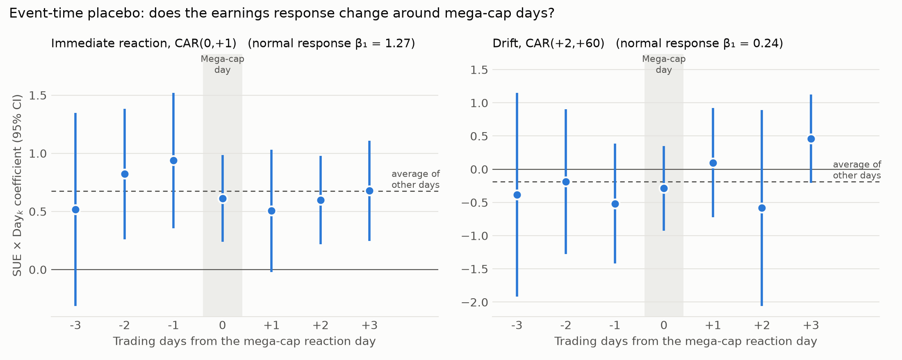

# Results

!!! info "Status"
    All results use the **full sample including delisted firms** (task 19):
    132,380 earnings releases, 75,050 with an earnings surprise, 15,284
    treated announcements on 139 mega-cap days. **Headline: β₃ ≈ 0. Mega-cap
    days crowd out attention, but not price discovery.**
    Sections go from the main result to how the data were built.

## Tables for the paper

Every table is a self-contained LaTeX `table` float (needs
`\usepackage{booktabs}`). From `paper/main.tex`, include one with
`\input{../output/tables/<file>}`.

| Paper table | File | Made by |
|---|---|---|
| 1. Sample by year | [`output/tables/summary.tex`](https://github.com/FIN-552-Applied-Econometrics-Research/megacap_attention/blob/main/output/tables/summary.tex) | `notebooks/10_summary.ipynb` |
| 2. Descriptive statistics | same file as Table 1 | `notebooks/10_summary.ipynb` |
| 3. Balance test | [`output/tables/balance.tex`](https://github.com/FIN-552-Applied-Econometrics-Research/megacap_attention/blob/main/output/tables/balance.tex) | `notebooks/10_summary.ipynb` |
| 4. Main regressions, all firms (base and + market move) | [`output/tables/main.tex`](https://github.com/FIN-552-Applied-Econometrics-Research/megacap_attention/blob/main/output/tables/main.tex) | `src/08_regress.py` |
| 5. Main regressions, small and low-coverage halves | [`output/tables/main_halves.tex`](https://github.com/FIN-552-Applied-Econometrics-Research/megacap_attention/blob/main/output/tables/main_halves.tex) | `src/08_regress.py` |
| 6. Calendar-time portfolio alphas | [`output/tables/alpha.tex`](https://github.com/FIN-552-Applied-Econometrics-Research/megacap_attention/blob/main/output/tables/alpha.tex) | `src/09_portfolio.py` |
| 7. Attention (Wikipedia pageviews) | [`output/tables/attention.tex`](https://github.com/FIN-552-Applied-Econometrics-Research/megacap_attention/blob/main/output/tables/attention.tex) | `src/11_attention.py` |
| 8. Robustness: same-week twins only | [`output/tables/robust_sameweek.tex`](https://github.com/FIN-552-Applied-Econometrics-Research/megacap_attention/blob/main/output/tables/robust_sameweek.tex) | `src/12_robust_sameweek.py` |
| 9. Robustness: news spillover | [`output/tables/robust_linked.tex`](https://github.com/FIN-552-Applied-Econometrics-Research/megacap_attention/blob/main/output/tables/robust_linked.tex) | `src/13_robust_linked.py` |
| 10. Drift under three return models | [`output/tables/drift_robust.tex`](https://github.com/FIN-552-Applied-Econometrics-Research/megacap_attention/blob/main/output/tables/drift_robust.tex) | `src/14_drift_robust.py` |
| 11. Adding delisted firms: before vs after | [`output/tables/main_with_delisted.tex`](https://github.com/FIN-552-Applied-Econometrics-Research/megacap_attention/blob/main/output/tables/main_with_delisted.tex) | `src/15_delisted.py report` |

| Figure | File | Made by |
|---|---|---|
| SUE distribution | `output/figures/sue_hist.png` | `src/04_sue.py` |
| CAR paths, treated vs control | `output/figures/car_paths.png` | `notebooks/06_car_checks.ipynb` |
| Event-time placebo | `output/figures/placebo.png` | `src/10_placebo.py` |

## Main result (β₃)

From `src/08_regress.py` (`output/tables/main.tex`, `main_halves.tex`).
1:1 matched sample; SUE, CARs and |market return| in percent; controls,
industry and quarter fixed effects; standard errors clustered by reaction day.
"+ Market move" adds |market return on the reaction day| and its interaction
with SUE.

**Table 4: all firms**

| | (1) CAR(0,+1) | (2) CAR(0,+1) + market move | (3) CAR(+2,+60) | (4) CAR(+2,+60) + market move |
|---|---|---|---|---|
| SUE (β₁) | 1.838*** (5.97) | 1.931*** (6.02) | −0.936 (−0.76) | −0.697 (−0.54) |
| MegaDay (β₂) | −0.141 (−0.97) | −0.144 (−0.96) | 0.404 (1.15) | 0.382 (1.07) |
| **SUE × MegaDay (β₃)** | **−0.081 (−0.33)** | **−0.019 (−0.07)** | **0.351 (0.61)** | **0.521 (0.90)** |
| \|Market return\| × SUE | | −0.134 (−0.90) | | −0.349 (−1.21) |
| **95% CI for β₃** | **[−0.56, 0.39]** | **[−0.52, 0.49]** | **[−0.78, 1.49]** | **[−0.61, 1.65]** |
| CI as % of β₁ | −30% to +21% | −27% to +25% | | |
| Fama-MacBeth β₃ | −0.204 (−0.72) | −0.247 (−0.64) | 0.504 (0.53) | 0.043 (0.04) |
| N | 30,135 | 30,135 | 29,430 | 29,430 |
| R² | 0.043 | 0.044 | 0.195 | 0.196 |

**Table 5: β₃ where crowding out should be strongest**

| | Small, CAR(0,+1) | Small, CAR(+2,+60) | Low cov., CAR(0,+1) | Low cov., CAR(+2,+60) |
|---|---|---|---|---|
| β₃, base | −0.194 (−0.74) | 0.485 (0.74) | −0.165 (−0.60) | 0.352 (0.49) |
| 95% CI | [−0.71, 0.32] | [−0.79, 1.76] | [−0.70, 0.37] | [−1.06, 1.76] |
| β₃, + market move | −0.133 (−0.48) | 0.660 (1.01) | −0.074 (−0.26) | 0.391 (0.54) |
| N | 14,983 | 14,633 | 15,022 | 14,674 |

*t*-statistics in parentheses. Crowding out (H1) predicts β₃ < 0 for
CAR(0,+1) and β₃ > 0 for CAR(+2,+60).

!!! abstract "What β₃ means"
    Across every specification, β₃ is close to zero and far from
    significant. A 1 percentage point earnings surprise moves the two-day CAR
    by 1.84% on an ordinary day (β₁, t = 5.97) and by essentially the same
    amount on a mega-cap day (β₃ = −0.08, t = −0.33). **The 95% confidence
    interval, [−0.56, 0.39], rules out a mega-cap-day effect larger than
    about 30% of the normal response in the crowding-out direction or 21% in
    the crowding-in direction.** The drift model, the small-firm and
    low-coverage halves, the market-move control and Fama-MacBeth estimates
    all agree. Two caveats bound the null: the interval still admits effects
    as large as the 17% macro-day effect of Hirshleifer and Sheng (2022), and
    there is no post-earnings drift in this period (β₁ for drift is
    insignificant) for a distraction effect to create.

!!! tip "How to report a null: lead with the interval"
    "Not significant" alone could mean the test is too noisy to detect
    anything. The confidence interval says what the data **rule out**. Report
    β₃'s interval in every table, and in the text scale it by the normal
    response β₁: "the earnings response on mega-cap days is within −30% to
    +21% of the normal response". Every robustness section below gives its
    interval for the same reason.

!!! info "Market move vs distraction (card 12)"
    Controlling for the size of the market move on the reaction day leaves
    β₃ essentially unchanged (−0.08 → −0.02 for CAR(0,+1); 0.35 → 0.52 for
    drift; all insignificant), so the market move was not hiding any crowding
    out.

## Adding delisted firms (Table 11)

From `src/15_delisted.py`. The original EDGAR pull started from the SEC's
*current* ticker list, so firms that stopped trading before late 2025 were
missing. Their 8-K Item 2.02 filings were added and every step re-run; CARs
include CRSP delisting returns (already inside `crsp.dsf_v2` daily returns,
flagged on 4,826 delisting days).

| | Survivors only | Full sample | Added |
|---|---|---|---|
| EDGAR 8-K 2.02 announcements | 105,088 | 132,380 | +27,292 |
| Firms (CIK) | 3,958 | 5,675 | +1,717 |
| Linked US common stocks | 82,735 | 107,539 | +24,804 |
| With SUE (price ≥ $5) | 59,775 | 75,050 | +15,275 |
| Treated announcements | 12,568 | 15,284 | +2,716 |
| Control announcements (distinct) | 8,310 | 10,162 | +1,852 |

82% of the added announcements come from delisted stocks. They are smaller
(median market cap $1.1B vs $2.7B) and miss expectations more often (35% vs
28%), exactly where distraction should matter most.

| β₃ | Survivors only | Full sample |
|---|---|---|
| CAR(0,+1) | −0.028 (t = −0.09), CI [−0.63, 0.58] | −0.081 (t = −0.33), CI [−0.56, 0.39] |
| CAR(+2,+60) | −0.191 (t = −0.29), CI [−1.48, 1.10] | 0.351 (t = 0.61), CI [−0.78, 1.49] |

The immediate-reaction result is unchanged and its interval is narrower. The
drift β₃ turns positive (the crowding-out direction) but stays far from
significant. The survivor-only sample was not hiding an effect.

## Robustness: same-week twins only (Table 8)

From `src/12_robust_sameweek.py`. 36% of treated announcements had no
same-industry twin in their own event week and borrowed one from elsewhere in
the quarter. Keeping only same-week pairs:

| | CAR(0,+1), all twins | CAR(0,+1), same week | CAR(+2,+60), all twins | CAR(+2,+60), same week |
|---|---|---|---|---|
| β₃, base | −0.081 (−0.33) | **−0.225 (−0.85)** | 0.351 (0.61) | 0.248 (0.35) |
| 95% CI | [−0.56, 0.39] | [−0.75, 0.30] | [−0.78, 1.49] | [−1.16, 1.65] |
| β₃, + market move | −0.019 (−0.07) | −0.129 (−0.45) | 0.521 (0.90) | 0.361 (0.52) |
| N | 30,135 | 19,461 | 29,430 | 18,756 |

| Mega-cap | Treated | Same-week twin | Kept |
|---|---|---|---|
| NVDA | 1,396 | 1,389 | 99% |
| AAPL | 4,289 | 3,858 | 90% |
| AMZN | 3,949 | 2,792 | 71% |
| GOOGL | 3,482 | 2,495 | 72% |
| MSFT | 3,884 | 2,629 | 68% |
| META | 5,360 | 2,006 | 37% |
| **All** | **15,284** | **9,858** | **64%** |

The restriction costs 36% of treated announcements and 36 of 139 events. β₃
moves towards crowding out (−0.08 → −0.23) but stays insignificant, and the
intervals overlap almost completely. The borrowed twins were not driving the
result.

## Robustness: news spillover (Table 9)

From `src/13_robust_linked.py`. Linked firms (7.8% of the sample): the
Fama-French 48 Chips industry, semiconductor equipment (SIC 3559), computer
and networking hardware (SIC 3570–3579), and 195 firms that name a mega-cap
as a major customer in Compustat Segments. Co-movement controls: each firm's
beta on the relevant mega-cap's daily return (days −250 to −30) and that beta
× the mega-cap's return on the reaction day.

| | CAR(0,+1) | CAR(+2,+60) |
|---|---|---|
| β₃, baseline | −0.081 (t = −0.33) | 0.351 (t = 0.61) |
| β₃, linked firms dropped | −0.081 (t = −0.33), CI [−0.57, 0.41] | 0.523 (t = 0.86), CI [−0.67, 1.72] |
| β₃, co-movement controls | −0.083 (t = −0.34) | 0.360 (t = 0.62) |

β₃ does not move when linked firms are dropped or co-movement is controlled
for. The null result is not spillover news cancelling a distraction effect.

## Robustness: drift under three return models (Table 10)

From `src/14_drift_robust.py`. CAR(+2,+60) under the market model,
market-adjusted returns (nothing estimated), and returns adjusted by the
firm's 5×5 size × book-to-market cell (a simplified DGTW benchmark).

| | Market model | Market-adjusted | Size/BM-adjusted |
|---|---|---|---|
| SUE (β₁) | −0.936 (t = −0.76) | −0.711 (−0.60) | −0.983 (−0.79) |
| MegaDay (β₂) | 0.404 (1.15) | 0.294 (0.85) | 0.210 (0.72) |
| **SUE × MegaDay (β₃)** | **0.351 (0.61)** | **0.607 (1.07)** | **0.689 (1.18)** |
| 95% CI for β₃ | [−0.78, 1.49] | [−0.50, 1.72] | [−0.45, 1.83] |
| Mean drift (%) | −1.40 | −0.44 | −0.41 |
| N | 29,430 | 29,430 | 28,125 |

!!! info "Why the versions differ (sentence for the paper)"
    The market model subtracts each stock's estimated pre-announcement alpha
    for 59 days, so stocks that fell before bad news (or rose before good
    news) mechanically show a reversal-like drift; market-adjusted and
    size/BM-adjusted returns carry no such trend, which moves β₃ from 0.35 to
    0.61 and 0.69, in the direction crowding out predicts, but none is
    significant and all three intervals overlap.

The conclusion does not depend on the return model, and no model shows
post-earnings drift at all (β₁).

## Calendar-time portfolio alphas (Table 6)

From `src/09_portfolio.py`. Each quarter, announcements are sorted into SUE
quintiles; the portfolio buys the top quintile and sells the bottom, holding
each from day +2 to +61, equal-weighted. Newey-West (10 lags) *t*-statistics;
factors from Ken French's data library.

| | Treated | Control | Treated − Control |
|---|---|---|---|
| CAPM alpha (% per year) | 6.32 (t = 1.76) | 7.85 (t = 1.83) | −1.06 (t = −0.23) |
| **FF5 + UMD alpha (% per year)** | **5.08 (t = 1.47)** | **6.85 (t = 1.64)** | **−1.26 (t = −0.27)** |
| Avg. stocks long / short | 84 / 68 | 55 / 48 | |
| Days (dropped: < 5 per side) | 1,977 (11) | 1,985 (8) | 1,974 |
| Break-even cost (bp per one-way trade) | 23.3 | 34.5 | |

No significant drift alpha in either group, treated firms earn slightly
*less* than controls (the opposite of crowding out), and break-even costs of
23–35 bp are at or below typical small- and mid-cap spreads.

## Event-time placebo

From `src/10_placebo.py`. The main model with SUE × Day\(_k\) for
\(k = -3, \dots, +3\) trading days from the nearest mega-cap day. Full sample of
72,478 non-mega-cap announcements; reference group: 4 or more trading days
from any mega-cap day.

| k | −3 | −2 | −1 | **0** | +1 | +2 | +3 |
|---|---|---|---|---|---|---|---|
| CAR(0,+1) | 0.52 (1.22) | 0.82 (2.88) | 0.94 (3.16) | **0.61 (3.21)** | 0.51 (1.88) | 0.60 (3.10) | 0.68 (3.08) |
| CAR(+2,+60) | −0.38 (−0.49) | −0.19 (−0.33) | −0.52 (−1.12) | **−0.29 (−0.88)** | 0.10 (0.24) | −0.58 (−0.77) | 0.46 (1.35) |

*t*-statistics in parentheses; β₁ = 1.27 (CAR(0,+1)), 0.24 (CAR(+2,+60)).

- **No peak at the mega-cap day.** Day 0 (0.61) is slightly *below* the
  average of the six surrounding days (0.68).
- The whole window around mega-cap days reacts more strongly than off-peak
  reporters: a peak-earnings-season effect, not anticipation of the
  mega-cap.

## Attention check (Table 7)

From `src/11_attention.py`. English Wikipedia pageviews (users, all access),
with each firm's page found through the SEC CIK recorded in Wikidata (P5531).
Abnormal views = log(1 + views on the reaction day) − log(1 + median daily
views over the 56 days ending 3 days before). 1:1 matched sample; 54% of
announcements have a page (7,439 treated, 7,399 control; 1,336 companies).

| | Treated | Control | Difference |
|---|---|---|---|
| Abnormal views, mean (log points) | 0.214 | 0.271 | −0.057 (t = −9.32) |
| Implied change vs baseline | +23.8% | +31.1% | |
| Matched pairs (4,594) | | | −0.062 (t = −8.70) |
| Regression on MegaDay, clustered by day | | | −0.057 (t = −4.41) |
| **+ controls** (day of week, quarter, industry, baseline views, size, analysts, same-day count) | | | **−0.032 (t = −4.02)** |
| Nvidia days only, with controls | | | −0.013 (t = −0.71) |
| Other five mega-caps, with controls | | | −0.032 (t = −3.95) |
| Same-event matches only, with controls | | | −0.020 (t = −2.16) |

!!! success "Attention moves, prices do not"
    **Attention to treated firms does drop on mega-cap days.** Both groups
    get more Wikipedia traffic on their earnings day, but treated firms get a
    smaller boost (+24% vs +31%). About half of the raw gap comes from timing
    (day of week and season); a robust gap of about 3% of views remains with
    full controls (t = −4.0). The drop comes from the five mega-caps that
    report in clustered peak weeks; Nvidia days alone show no significant
    drop.

    Put together with β₃ ≈ 0 (Table 4), mega-cap days **crowd out attention
    but not price discovery**: earnings news is priced just as fast and as
    fully even when fewer people look at the firm. Professional and
    algorithmic readers of disclosures, not the casual attention Wikipedia
    measures, set prices on earnings days.

Caveats: Wikipedia measures mostly retail and casual attention, and firms
with a page are larger and better known than the average sample firm.

## Sample and balance

From `notebooks/10_summary.ipynb` (`output/tables/summary.tex`,
`output/tables/balance.tex`), 1:1 matched sample.

### Table 1: sample by year

| Year | Events | Treated ann. | Treated firms | Control ann. (1:1) | Control firms (1:1) | Control ann. (1:3) |
|---|---|---|---|---|---|---|
| 2018 | 19 | 2,143 | 1,177 | 1,258 | 963 | 2,205 |
| 2019 | 20 | 2,022 | 1,086 | 1,304 | 944 | 2,349 |
| 2020 | 15 | 1,437 | 888 | 1,056 | 841 | 2,206 |
| 2021 | 16 | 1,855 | 1,022 | 1,315 | 998 | 2,677 |
| 2022 | 18 | 1,973 | 937 | 1,334 | 942 | 2,677 |
| 2023 | 18 | 2,162 | 1,099 | 1,382 | 971 | 2,622 |
| 2024 | 17 | 1,936 | 1,125 | 1,324 | 1,013 | 2,664 |
| 2025 | 16 | 1,756 | 1,051 | 1,189 | 921 | 2,397 |
| **Total** | **139** | **15,284** | **2,442** | **10,162** | **2,804** | **19,797** |

Firm totals count each firm once.

### Table 2: descriptive statistics (1:1 sample)

| | Treated mean | Treated median | Treated SD | Control mean | Control median | Control SD |
|---|---|---|---|---|---|---|
| SUE (% of price) | 0.120 | 0.082 | 0.971 | 0.123 | 0.082 | 0.869 |
| Negative surprise (share) | 0.248 | 0 | 0.432 | 0.241 | 0 | 0.428 |
| Log market cap ($M) | 8.085 | 8.014 | 1.744 | 8.108 | 8.041 | 1.715 |
| Book-to-market | 0.519 | 0.411 | 0.430 | 0.495 | 0.385 | 0.421 |
| Log(1 + analysts) | 2.110 | 2.079 | 0.691 | 2.133 | 2.197 | 0.681 |
| Past return, −12 to −2 (%) | 16.94 | 8.21 | 49.54 | 16.22 | 7.20 | 51.09 |
| Same-day announcements | 201.4 | 207 | 70.6 | 184.2 | 151 | 122.6 |
| CAR(0,+1) (%) | 0.088 | 0.096 | 8.675 | 0.268 | 0.305 | 9.085 |
| CAR(+2,+60) (%) | −1.207 | −1.076 | 18.383 | −1.587 | −0.854 | 20.780 |

N = 15,284 per group (fewer where a variable is missing; see `summary.tex`).

### Table 3: balance test

| Variable | Treated | Control | Difference | *t* | Std. diff. |
|---|---|---|---|---|---|
| SUE (% of price) | 0.120 | 0.123 | −0.003 | −0.25 | −0.003 |
| Negative surprise (share) | 0.248 | 0.241 | 0.007 | 1.33 | 0.015 |
| Log market cap | 8.085 | 8.108 | −0.022 | −1.13 | −0.013 |
| Book-to-market | 0.519 | 0.495 | 0.023*** | 4.68 | 0.055 |
| Log(1 + analysts) | 2.110 | 2.133 | −0.023*** | −2.92 | −0.033 |
| Past return (%) | 16.94 | 16.22 | 0.72 | 1.25 | 0.014 |
| Same-day announcements | 201.4 | 184.2 | 17.2*** | 15.02 | **0.172** |

!!! success "Balance verdict"
    **The groups are balanced on everything a firm could choose or that
    matching targeted.** SUE is almost identical (0.120% vs 0.123% of price,
    *t* = −0.25, std. diff. −0.003), and so is the share of negative
    surprises (24.8% vs 24.1%), so there is no sign that firms pick mega-cap
    days to hide bad news; every other pre-announcement variable has a
    standardized difference below 0.06, and the two significant ones
    (book-to-market and analyst coverage) are significant only because of the
    large sample. The one real difference is the same-day announcement count
    (std. diff. 0.17), higher by construction because mega-cap days fall in
    peak earnings weeks; it enters every regression as a control.

## Treated / control matching

From `src/05_match.py` (`output/match_summary.md`):

- **15,284 treated announcements** from 2,442 firms on **139 mega-cap
  events**, every one matched.
- **Controls (1:1, with replacement):** 10,162 announcements from 2,804
  firms. The 1:3 robustness match uses 19,797.
- 64% matched within the same event and FF12 industry; 36% used the
  same-quarter fallback (see the same-week robustness above).

| Mega-cap | Treated | Same-week twin available |
|---|---|---|
| NVDA | 1,396 | 99% |
| AAPL | 4,289 | 90% |
| AMZN | 3,949 | 71% |
| GOOGL | 3,482 | 72% |
| MSFT | 3,884 | 68% |
| META | 5,360 | 37% |

| Balance (1:1, medians) | Treated | Control |
|---|---|---|
| Market cap ($M) | 3,052 | 3,134 |
| SUE (% of price) | 0.082 | 0.082 |
| % miss | 24.8% | 24.1% |
| Analysts | 7 | 8 |

## Abnormal returns (CAR)

From `src/06_car.py` (`output/car_summary.md`). Market = CRSP value-weighted
index (CIZ indno 1000200, identical to legacy `vwretd`). Delisting returns
are included in the CRSP daily returns.

| | Coverage |
|---|---|
| CAR(0,+1), market model | 98.2% |
| CAR(0,+1), market-adjusted | 100% |
| CAR(+2,+60), market model | 95.2% (missing after 2 Oct 2025: not enough data yet) |
| Windows cut short by delisting | 603 |

**WRDS spot check (10 random events, survivor-only run):** daily returns
identical to the WRDS Event Study tool; CAR(0,+1) within 0.09 percentage
points; CAR(+2,+60) within 1.55 pp (mean about 0.4 pp), because the tool's
market benchmark differs slightly from `vwretd`. The CAR method did not
change with the full sample; the 10 events in `output/car_spotcheck_input.txt`
are a new random draw if the check is repeated.

### First look: CAR path, treated vs control

1:1 matched sample with a complete +60 window; descriptive only.

| | Day +1 | Day +60 |
|---|---|---|
| Beat, treated / control | 1.77% / 1.90% | 0.44% / 0.29% |
| Miss, treated / control | −3.25% / −3.04% | −4.23% / −4.21% |

Treated and control paths are nearly identical on day 0 and over the
following 60 days.

### Drift by surprise quintile (mean CAR, %)

| SUE quintile | CAR(0,+1) control | CAR(0,+1) treated | CAR(+2,+60) control | CAR(+2,+60) treated |
|---|---|---|---|---|
| Q1 (worst) | −4.05 | −3.84 | −0.77 | −0.35 |
| Q2 | −1.34 | −2.06 | −2.28 | −1.78 |
| Q3 | 0.43 | 0.02 | −2.27 | −1.75 |
| Q4 | 1.66 | 1.72 | −1.08 | −1.28 |
| Q5 (best) | 3.81 | 3.91 | −1.08 | −0.43 |
| **Q5 − Q1** | **7.85** | **7.75** | **−0.31** | **−0.08** |

The immediate long-short spread is the same for treated and control firms,
and there is no long-short drift in either group (market-model CARs; see
Table 10 for other return models).

## Earnings surprise (SUE)

From `src/04_sue.py` (`output/sue_summary.md`):

| Step | Announcements | % of linked sample |
|---|---|---|
| Linked US common stocks | 107,539 | 100.0% |
| Matched to an I/B/E/S actual (within 3 days) | 91,760 | 85.3% |
| With a consensus before the release | 90,991 | 84.6% |
| Price ≥ $5 | **75,050** | 69.8% |

| Year | N | Miss | Meet | Beat | % miss | Median SUE (% of price) | Median analysts |
|---|---|---|---|---|---|---|---|
| 2018 | 9,161 | 2,642 | 624 | 5,895 | 28.8% | 0.060 | 7 |
| 2019 | 9,034 | 2,885 | 560 | 5,589 | 31.9% | 0.051 | 7 |
| 2020 | 8,915 | 2,556 | 346 | 6,013 | 28.7% | 0.117 | 7 |
| 2021 | 10,481 | 2,861 | 353 | 7,267 | 27.3% | 0.112 | 6 |
| 2022 | 9,866 | 3,086 | 446 | 6,334 | 31.3% | 0.080 | 7 |
| 2023 | 9,309 | 2,898 | 410 | 6,001 | 31.1% | 0.077 | 7 |
| 2024 | 9,260 | 2,848 | 434 | 5,978 | 30.8% | 0.068 | 7 |
| 2025 | 9,024 | 2,424 | 420 | 6,180 | 26.9% | 0.080 | 7 |

- 2,400 to 3,100 misses every year (27% to 32%).
- EDGAR and I/B/E/S dates agree on the same day for 94.7%; for 4.1% I/B/E/S
  is earlier (the press release came out before the 8-K). 21 observations
  needed a split adjustment.

## Control variables

From `src/07_controls.py` (`output/controls_summary.md`):

| Control | Missing (all) | Missing (1:1 sample) | Median |
|---|---|---|---|
| logsize | 0.0% | 0.0% | 7.67 (≈ $2.1B) |
| bm | **6.9%** | **5.0%** | 0.39 |
| log_analysts | 0.0% | 0.0% | 2.08 (7 analysts) |
| pastret | 2.7% | 1.3% | 6.5% |
| samedaycount | 0.0% | 0.0% | 169 |

`bm` is above 5% because 4,788 announcements come from firms with negative or
zero book equity (book-to-market undefined; set to 0 with a dummy in the
regressions); only 372 lack Compustat data.

## Data availability

WRDS access check, run 2026-11-22 (`src/00_check_wrds_access.py`):

| Table | Latest date | Notes |
|---|---|---|
| `crsp.dsf` | 2024-12-31 | Legacy format, no longer updated |
| `crsp.dsf_v2` | **2025-12-31** | New CIZ format. **This is what sets the sample end** |
| `crsp.inddlyseriesdata` | 2025-12-31 | CRSP daily index series |
| `ibes.actu_epsus` | 2026-08-20 | I/B/E/S actual EPS |
| `ibes.statsum_epsus` | 2026-08-20 | I/B/E/S consensus |
| `comp.fundq` (`rdq`) | 2026-11-20 | Compustat report dates |
| `ff.fivefactors_daily` | 2026-09-30 | Fama-French factors |

**Decision:** the sample ends **2025-12-31**. Announcements up to mid-December
2025 keep a full post-announcement window.

## EDGAR release times

132,380 8-K Item 2.02 filings from 2018 to 2025 (`src/01_edgar.py`), from the
SEC's current ticker list plus 2,146 CIKs of firms missing from it (mostly
delisted; task 19).

| Year | Filings | Firms |
|---|---|---|
| 2018 | 15,548 | 3,825 |
| 2019 | 15,439 | 3,833 |
| 2020 | 16,110 | 3,877 |
| 2021 | 17,042 | 4,276 |
| 2022 | 17,714 | 4,333 |
| 2023 | 17,334 | 4,250 |
| 2024 | 16,831 | 4,144 |
| 2025 | 16,362 | 4,071 |

With delisted firms included, the firm count is roughly flat over time; the
survivor-only list had climbed from 2,555 firms in 2018 to 3,736 in 2025.

**Release timing:**

| Window (ET) | Filings | Share |
|---|---|---|
| Before open (before 09:30) | 47,497 | 36% |
| During market hours | 8,863 | 7% |
| After close (16:00 or later) | 76,020 | 57% |

### Finding: SEC timestamps are UTC, not Eastern

Older advice says the `acceptanceDateTime` field's "Z" really means Eastern
time. **For the SEC submissions API this is wrong.** Nvidia's releases show
21:2x in winter and 20:2x in summer, which is 16:2x ET all year. Only true UTC
shifts with daylight saving like that. After conversion, every filing falls
inside EDGAR's 06:00 to 22:00 ET operating hours.

| Nvidia release | Accepted (ET) |
|---|---|
| 2025-02-26 | 16:21:32 |
| 2025-05-28 | 16:21:30 |
| 2025-08-27 | 16:22:14 |
| 2025-11-19 | 16:20:44 |
| 2026-08-26 | 16:21:19 (validation case) |

## Reaction days and mega-cap days

From `src/02_reaction_day.py`:

- **139 distinct mega-cap reaction days** from 2018 to 2025 (6 firms × 32
  scheduled releases = 192, with some days shared by two firms).
- **21,723 treated releases** (other firms whose reaction day is a mega-cap
  day), about 16% of all releases.
- 8,843 releases (6.7%) are intraday.
- Four mega-cap 2.02 filings are unscheduled revenue warnings or previews and
  are excluded from treatment (see the [Data guide](data.md)).

| Trading days from nearest mega day | −5 | −4 | −3 | −2 | −1 | **0** | +1 | +2 | +3 | +4 | +5 |
|---|---|---|---|---|---|---|---|---|---|---|---|
| Releases | 5,216 | 4,774 | 3,807 | 5,156 | 8,907 | **21,723** | 7,838 | 7,774 | 8,198 | 11,125 | 8,929 |

### Validation: Nvidia, 26 August 2026

`python src/02_reaction_day.py --check` applies the rule to every 8-K Item
2.02 filed on 26 and 27 August 2026:

- **Nvidia** (16:21 Wed) and **Veeva** (16:06 Wed) both get reaction day
  **27 Aug**. Pass.
- **29 filers** have reaction day 27 Aug (Wed after close or Thu before open),
  against 15 major firms on Bloomberg's list. These include Salesforce,
  CrowdStrike, Okta, Nutanix, HP, Synopsys, Agilent, Dollar Tree, Dollar
  General, Best Buy and Burlington.
- **13 filers** reported Wed morning and are **not treated** (Kohl's,
  Smucker, Abercrombie & Fitch, Williams-Sonoma and others), even though they
  share Nvidia's calendar date.
- Some filers are funds or crypto-treasury shells (e.g. Fidelity Private
  Credit Fund, Hyperliquid Strategies). The US common-stock filter in
  `03_links.py` removes them.
- Three intraday releases are flagged with `intraday = 1`.

## Identifier links

From `src/03_links.py` (`output/match_rate.md`), checked at each announcement date:

| Step | Announcements | % of all |
|---|---|---|
| All EDGAR 8-K 2.02 announcements | 132,380 | 100.0% |
| with GVKEY | 132,267 | 99.9% |
| with PERMNO (CCM link in range) | 127,689 | 96.5% |
| with I/B/E/S ticker | 120,789 | 91.2% |
| US common stock | 113,117 | 85.4% |
| **US common stock with all three IDs (sample)** | **107,539** | 81.2% |

**Match rate among US common stocks: 95.1%** (target 90%), every year between
93.8% and 96.0%.

| Year | US common | All three IDs | Rate |
|---|---|---|---|
| 2018 | 13,216 | 12,690 | 96.0% |
| 2019 | 13,118 | 12,549 | 95.7% |
| 2020 | 13,696 | 13,086 | 95.5% |
| 2021 | 14,637 | 13,735 | 93.8% |
| 2022 | 15,347 | 14,581 | 95.0% |
| 2023 | 14,941 | 14,190 | 95.0% |
| 2024 | 14,341 | 13,597 | 94.8% |
| 2025 | 13,821 | 13,111 | 94.9% |

## Early analysis: Nvidia, 26 August 2026

From the proposal, using Bloomberg's calendar of major US firms:

| Group | Firms | Median surprise | Mean surprise |
|---|---|---|---|
| Wed before open (not treated) | 4 | 30.6% | 56.9% |
| Wed after close and Thu before open (**treated**) | 15 | 15.5% | 30.3% |
| Thu after close (day +1, skipped) | 9 | 7.4% | 180.3% |

- The reaction-day rule matters: four firms on Nvidia's calendar date reported
  before the open and are not treated.
- Every firm with an estimate beat it, so the full sample is needed to get
  enough negative surprises.
- Percentage surprises are badly skewed, which is why SUE is scaled by price
  and winsorized.
